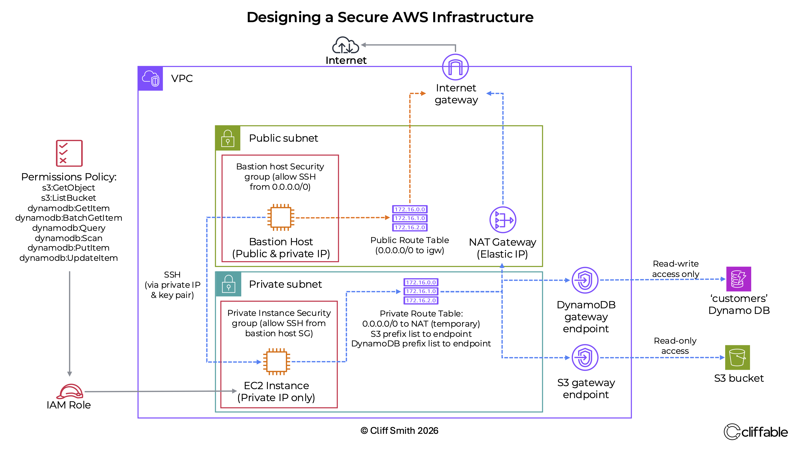
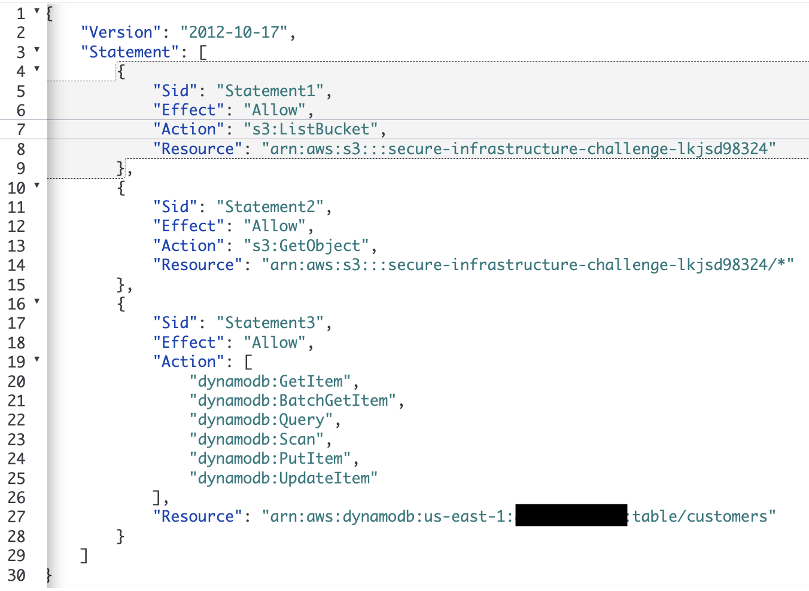

# Secure AWS Infrastructure

A security-focused AWS architecture designed and implemented from a set of technical requirements, using private networking, controlled administrative access, Gateway VPC Endpoints and least-privilege IAM.

## Overview

The goal of this project was to design, build and validate an AWS environment in which a workload EC2 instance remained private while retaining tightly controlled access to the AWS services it required.

I was given a set of technical and security requirements, and designed the architecture to meet them. I planned the network architecture, route tables and IAM permissions before creating the AWS resources, then implemented, troubleshot and validated the completed environment.

### Key requirements

- Place the workload EC2 instance in a private subnet with no public IP address.
- Provide SSH administration without exposing the private instance directly to the internet.
- Allow temporary internet access while installing required Python packages.
- Provide read-only access to Amazon S3.
- Provide read and write access to DynamoDB while preventing delete operations.
- Maintain access to S3 and DynamoDB after removing workload internet connectivity.

## Architecture

The architecture uses a custom VPC containing a public subnet and a private subnet.

A bastion host in the public subnet provides the administrative path to the workload EC2 instance. The workload itself remains in the private subnet with no public IP address.

A NAT Gateway initially provided outbound internet connectivity while the required Python packages were installed. After installation, the default route to the NAT Gateway was removed from the private route table.

Gateway VPC Endpoints for Amazon S3 and DynamoDB allow the workload to continue communicating with those services without requiring internet connectivity.

## Key Design Decisions

### Private workload instance

The workload EC2 instance was placed in a private subnet without a public IP address, preventing direct inbound access from the internet.

### Bastion host for administration

A bastion host in the public subnet provides the SSH entry point to the private workload.

This keeps the workload itself private, although it introduces an additional EC2 instance that must be secured and managed.

### Temporary NAT Gateway routing

The private instance required outbound connectivity while installing `boto3` and its dependencies.

A NAT Gateway provided this access temporarily. Once installation was complete, I removed the private subnet's default route to the NAT Gateway rather than deleting the gateway.

This allowed internet connectivity to be removed from the workload while preserving the option to restore it if required.

### Gateway VPC Endpoints

Gateway VPC Endpoints were configured for Amazon S3 and DynamoDB.

These provide private routes to the AWS services so the workload does not depend on the NAT Gateway or public internet for S3 and DynamoDB access.

### Least-privilege IAM

Rather than attaching broad AWS-managed policies, I created a custom IAM permissions policy for the workload.

The policy grants:

- S3 object read access and bucket listing.
- DynamoDB read and write operations.
- No S3 write access.
- No DynamoDB delete permission.

The policy was attached to an IAM role assigned to the private EC2 instance, allowing temporary role credentials to be supplied automatically.

## Implementation Challenges

### SSH access to the private instance

My initial SSH approach failed because the private EC2 instance required key-pair authentication.

I launched a replacement instance with the correct key pair and successfully connected through the bastion host.

### Missing IAM credentials

The validation script initially failed after the private EC2 instance was replaced.

Networking and VPC endpoint access appeared correct, so I checked the instance credentials and discovered that the replacement instance had been launched without the required IAM role.

Attaching the correct IAM role resolved the problem.

### Removing internet access without breaking AWS connectivity

After installing the required software, I removed the default route to the NAT Gateway from the private route table.

The instance could no longer reach the public internet, but S3 and DynamoDB operations continued to work through their Gateway VPC Endpoints.

This confirmed that access to those services was no longer dependent on internet connectivity.

## Validation

The completed environment was tested using a supplied Python validation script.

The tests confirmed:

- SSH access through the bastion host succeeded.
- The workload EC2 instance had no public IP address.
- The workload had no active route to the internet.
- S3 read operations succeeded.
- S3 write operations were denied.
- DynamoDB read and write operations succeeded.
- DynamoDB delete operations were denied.
- IAM role credentials were supplied automatically to the instance.
- S3 and DynamoDB remained accessible after the NAT Gateway route was removed.
- The infrastructure validation script completed successfully.

## Security

The project applies several security principles:

- Workloads are isolated in a private subnet.
- The workload has no public IP address.
- Administrative access is separated through a bastion host.
- Internet access is removed when no longer required.
- AWS service traffic uses Gateway VPC Endpoints.
- IAM permissions follow least privilege.
- EC2 obtains AWS credentials through an IAM role rather than stored access keys.
- Explicit validation confirms that prohibited operations are denied.

## Cost Considerations

The environment was created for implementation and validation rather than continuous operation.

The EC2 instances incurred charges only while running, while the NAT Gateway incurred an hourly charge while deployed. Gateway VPC Endpoints for S3 and DynamoDB do not have an hourly endpoint charge.

For a longer-lived environment, removing unnecessary NAT Gateway infrastructure would therefore be an important cost consideration.

## What I Learned

This project was an important step from following predefined architectures towards designing infrastructure from requirements.

It reinforced the relationship between:

- Subnets and route tables
- Internet and private AWS service connectivity
- EC2 instance roles and temporary credentials
- IAM permissions and application behaviour
- Network isolation and operational access
- Architecture design and validation

It also demonstrated the value of designing the architecture before implementation. Defining the network paths, IAM permissions and security boundaries first made implementation and troubleshooting considerably clearer.

## Potential Improvements

For a production implementation I would consider:

- Replacing the bastion host with AWS Systems Manager Session Manager to eliminate inbound SSH access.
- Deploying across multiple Availability Zones.
- Defining the infrastructure using Infrastructure as Code.
- Adding additional monitoring and logging.
- Removing the NAT Gateway entirely when outbound internet connectivity is no longer required.

## Further Reading

A more detailed project case study, including the design decisions and troubleshooting process, is available on my portfolio:

https://cliffable.com/projects/designing-a-secure-aws-infrastructure.html

## Technologies

`AWS` `Amazon VPC` `EC2` `IAM` `Amazon S3` `DynamoDB` `VPC Endpoints` `NAT Gateway` `Python` `boto3`